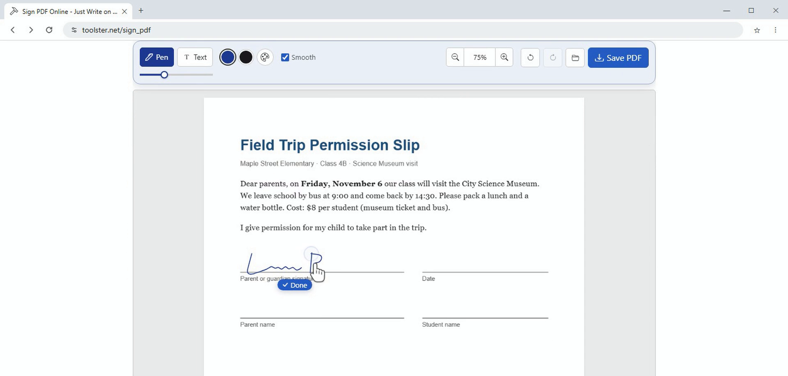

# pdf-send-check

A read-only report on the parts of a PDF that go with it when you email or upload it: earlier saves still inside the file, marks left as movable annotations, fillable form fields, the author name in the document info, attached files and script actions. One script, Node 18 or later, no package dependencies, MIT license.

```bash
npm test
node scripts/pdf-send-check.js form.pdf
node scripts/pdf-send-check.js *.pdf --json      # machine-readable report
node scripts/pdf-send-check.js out.pdf --strict  # exit code 1 if anything is flagged
```

The file is only read, never changed. Exit code 2 means the file could not be read as a PDF.

## Example: a permission slip before and after signing

The same one-page form, first as printed from the browser, then after a signature was drawn on it and the copy was saved:

```
$ node scripts/pdf-send-check.js "Field trip permission.pdf" "Field trip permission-signed.pdf"
Field trip permission.pdf: PDF 1.4, 1 page, saved 1 time
  annotations: none
  form fields: 0
  document info: Title, Creator, Producer, CreationDate, ModDate
    Title: Field Trip Permission Slip
  attachments: 0, scripts: no, encrypted: no
  nothing to flag

Field trip permission-signed.pdf: PDF 1.7, 1 page, saved 1 time
  annotations: none
  form fields: 0
  document info: Title, Creator, Producer, CreationDate, ModDate
    Title: Field Trip Permission Slip
  attachments: 0, scripts: no, encrypted: no
  nothing to flag
```

No annotations and a single save in the signed copy: the signature is part of the page itself, so the school cannot drag it off or delete it as a separate object, and the unsigned version is not hidden inside the file. Some editors do it the other way: they add the signature as an `Ink` or `Stamp` annotation and append the change to the end of the file. On such a file the report looks like this:

```
contract.pdf: PDF 1.7, 2 pages, saved 2 times
  annotations: Ink 1
  ...
  check before sending:
    - saved 2 times: the earlier version is still inside the file and can be recovered
    - 1 mark(s) are annotations: the reader can move or delete them
```



## Example: a Word file turned into a PDF

```
$ node scripts/pdf-send-check.js "Garden plan.pdf"
Garden plan.pdf: PDF 1.7, 1 page, saved 1 time
  ...
    Title: Community Garden: Spring Plan
    Author: Garden committee
  check before sending:
    - document info has an Author name
```

The title and author were typed into the Word file's properties and came along into the PDF. Here that is what we wanted; with a CV or a complaint letter you may want to clear the author field in Word before converting.

On a 14-page public domain excerpt of Alice in Wonderland the report also found one page object that is not in the page list: no reader shows it, but its content is still in the file. Such leftovers usually stay behind after editing.

## What is checked

| Line | What it means |
|---|---|
| saved N times | Each save appended to the file. Text you removed may still be there in the earlier part. |
| annotations | Marks stored on top of the page. `Link` is harmless; `Ink`, `FreeText`, `Stamp`, shapes and highlights can be moved or deleted by whoever opens the file. |
| form fields | Fillable fields (`Widget`). The recipient can change the values. |
| document info | Title, Author, Subject, Keywords, Creator, Producer and dates. Title, Author, Subject and Keywords are printed in full. |
| attachments, scripts | Embedded files and script actions travel with the PDF and some mail filters block them. |
| page objects not in the page list | Pages a reader will not show, still stored in the file. |

The checker reads plain and compressed object streams and files saved more than once. Encrypted files are reported as encrypted and their document info is skipped. It is a quick look, not a full validator: a damaged file can give an incomplete report.

A printable version of the same points for people who do not use a terminal: [checklist.md](checklist.md).

## Browser PDF tools

We maintain these tools. They cover the steps around the check: read the file, sign or mark it up, convert it, pack it. Try it here:

| Task | Tool | Note for the check |
|---|---|---|
| Sign a form | [Sign PDF](https://toolster.net/sign_pdf) | The example above. The pen signature went into the page itself. |
| Draw, underline, add notes | [Draw on PDF](https://toolster.net/draw_on_pdf) | Pen and highlighter marks. Run the check on the saved copy to see how they were stored. |
| Look through a file before sending | [PDF viewer](https://toolster.net/pdf_viewer) | Shows bookmarks and attachments too, so you can see what the script reports. |
| Edit the text | [PDF to Word](https://toolster.net/pdf_to_word) | Returns an editable DOCX. Clear the author field there if needed. |
| Make a PDF from a document | [Word to PDF](https://toolster.net/word_to_pdf) | The "Garden plan" example. Title and author come from the Word file. |
| Read a long book | [PDF book reader](https://toolster.net/pdf_book_reader) | One page or two-page spreads, trims white margins of scans. |
| Read comics and scans | [PDF comic reader](https://toolster.net/pdf_comic_reader) | Spreads, right-to-left mode for manga, webtoon scrolling. |
| Send several PDFs at once | [PDF to ZIP](https://toolster.net/pdf_to_zip) | Packs PDF files into one .zip, with a password if you want one. Check each PDF first. |
| One PDF from an archive | [ZIP to PDF](https://toolster.net/zip_to_pdf) | Images and documents from a .zip or .rar become one PDF. |

Russian and Spanish versions of the site: [ru.toolster.net](https://ru.toolster.net/), [es.toolster.net](https://es.toolster.net/). All tools: [toolster.net](https://toolster.net).

## Video

Video tutorial with five of these tools, including signing the permission slip from the example: [5 free PDF tools](https://youtu.be/PTGzzBIFT1o).

The site source code is not included. This repository contains only the independent check script, its tests and the checklist.
